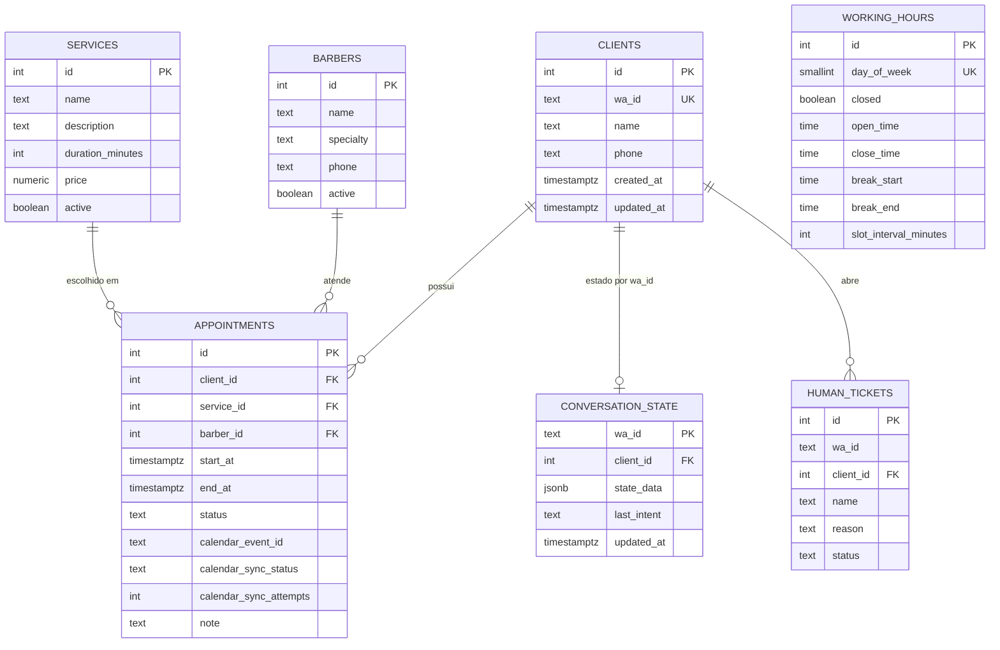

# 01 — Arquitetura da solução

> **Sumário**
>
> 1. [Visão geral em um diagrama](#1-visão-geral-em-um-diagrama)
> 2. [Fluxo de uma mensagem, passo a passo](#2-fluxo-de-uma-mensagem-passo-a-passo)
> 3. [Contrato de payload neutro (§2 do contrato)](#3-contrato-de-payload-neutro-2-do-contrato)
> 4. [Princípio do adaptador isolado](#4-princípio-do-adaptador-isolado)
> 5. [Modelo de dados (PostgreSQL 15)](#5-modelo-de-dados-postgresql-15)
> 6. [As seis ferramentas do agente](#6-as-seis-ferramentas-do-agente)
> 7. [Workflow principal e workflow de sincronização](#7-workflow-principal-e-workflow-de-sincronização)
> 8. [Limites e decisões de design](#8-limites-e-decisões-de-design)

---

## 1. Visão geral em um diagrama

```mermaid
flowchart LR
    A[Cliente WhatsApp] -->|mensagem de texto| B[Ponte Baileys<br/>bridge/server.js<br/>Node.js + express]
    B -->|POST webhook payload neutro §2.1| C[Webhook n8n<br/>whatsapp/incoming]
    C --> D[Normalizar Mensagem<br/>+ Carregar Estado da Conversa]
    D --> E[Agente Gemini<br/>gemini-2.0-flash<br/>6 ferramentas]
    E -->|chamadas de tool| F[Sub-workflows n8n/tools/]
    F --> G[(PostgreSQL 15<br/>appointments, clients...)]
    G -->|calendar_sync_status = pending| H[Workflow calendar-sync<br/>cron a cada 1 minuto]
    H -->|create / update / delete| I[Google Calendar<br/>OAuth Google Calendar OAuth]
    I -->|link público ICS / CalDAV| J[Apple Calendar<br/>assinatura somente leitura]
    E -.->|palavra-chave atendente| K[Registrar Ticket Humano<br/>human_tickets]
    K -->|human_handoff = true| B
    E -->|resposta final §2.2| B
    B -->|mensagem de volta| A
```



**Leitura do diagrama:**

- Os retângulos `A → B → C → E → G` formam o caminho síncrono de uma conversa: a resposta volta pelo mesmo webhook (§2.2) em até `MESSAGE_TIMEOUT_MS` (padrão 25000 ms).
- A seta `G → H → I` é o caminho **assíncrono**: o agendamento não depende do Google Calendar para existir; ele nasce no PostgreSQL como `pending` e é sincronizado em seguida.
- A seta `I → J` é **somente leitura**: o Apple Calendar apenas assina o calendário público do Google (ver [06-sincronizacao-apple-calendar.md](06-sincronizacao-apple-calendar.md)).
- A ramificação `E → K → B` é a transferência para atendente humano: o ticket fica em `human_tickets` e a ponte só repassa a mensagem de aviso já formatada.

---

## 2. Fluxo de uma mensagem, passo a passo

1. **Cliente** envia texto no WhatsApp (ex.: "quero agendar um corte de cabelo").
2. **Ponte Baileys** (`bridge/server.js`) descarta grupos (`@g.us`), mensagens próprias (`fromMe`) e status; extrai `message.conversation` ou `extendedTextMessage.text`; monta o JSON neutro da §2.1 e faz `POST` em `N8N_WEBHOOK_URL` (padrão `http://localhost:5678/webhook/whatsapp/incoming`).
3. **Workflow principal** (`workflow-barbearia-whatsapp.json`):
   1. **Webhook Recebimento WhatsApp** (`n8n-nodes-base.webhook`, `responseMode: "responseNode"`);
   2. **Normalizar Mensagem** (`set`) — campos `wa_id`, `sender_name`, `message_text`, `message_id`, `timestamp`;
   3. **Carregar Estado da Conversa** (`postgres`) — `SELECT * FROM conversation_state WHERE wa_id = $1`;
   4. **Agente Gemini (Ferramentas)** (`n8n-nodes-langchain.agent`, `toolsAgent`) conectado ao modelo `gemini-2.0-flash` e às 6 ferramentas `n8n-nodes-langchain.toolWorkflow`;
   5. **Salvar Estado da Conversa** (`postgres`) — upsert em `conversation_state`;
   6. **Verificar Erro** (`if`): sucesso → **Montar Resposta Final** (`code`) no formato §2.2; erro → **Registrar Ticket Humano** (`postgres`, insert em `human_tickets`) + código de fallback com `human_handoff: true`;
   7. **Responder Webhook** (`respondToWebhook`) — HTTP 200 com `{ "messages": [...], "human_handoff": false }`.
4. **Ponte Baileys** recebe o §2.2 e, para cada item de `messages[]`, chama `sock.sendMessage(jid, { text })`.
5. Quando um agendamento é criado, `calendar_sync_status='pending'`; o **workflow de sincronização** (`workflow-calendar-sync.json`) varre pendentes a cada 1 minuto, cria o evento no Google Calendar e marca `synced`, ou `failed` com `calendar_sync_attempts + 1` (até 5 tentativas). Cancelamentos também disparam a remoção do evento.

---

## 3. Contrato de payload neutro (§2 do contrato)

O n8n **nunca** recebe um objeto específico do Baileys (não há `key`, `pushName`, `messageTimestamp`, `jid`, etc. nos workflows). A ponte traduz tudo para três formatos fixos.

### 3.1 Entrada: ponte → n8n (§2.1)

`POST {N8N_WEBHOOK_URL}`, `Content-Type: application/json`:

```json
{
  "provider": "baileys",
  "wa_id": "5511999990000",
  "sender_name": "Cliente Exemplo",
  "message_id": "BAILEYS_MSG_ID_ABC123",
  "message_type": "text",
  "message_text": "quero agendar um corte de cabelo",
  "timestamp": 1731100000000
}
```

| Campo | O que é | Observação |
|---|---|---|
| `provider` | Origem da mensagem | Versão atual `"baileys"`; o adaptador futuro da Meta enviará `"meta"`. |
| `wa_id` | Número do cliente, formato internacional sem `@s.whatsapp.net` | Chave de conversa (`conversation_state.wa_id`) e de `clients.wa_id`. |
| `sender_name` | Nome de exibição do WhatsApp | Preenchido em `clients.name` quando ausente. |
| `message_id` | ID da mensagem original | Rastreabilidade/logs; não usado como chave de negócio. |
| `message_type` | `text`, `image`, `audio`, etc. | Mídia não textual segue com `message_text` vazio; a ponte avisa que só entende texto no momento. |
| `message_text` | Texto da mensagem | Vazio para mídia. |
| `timestamp` | Epoch em milissegundos | Usado para ordenação e diagnóstico. |

### 3.2 Resposta síncrona: n8n → ponte (§2.2)

HTTP 200 do webhook:

```json
{
  "messages": [
    { "to": "5511999990000", "type": "text", "text": "Olá! Eu sou a Bia, atendente virtual..." }
  ],
  "human_handoff": false
}
```

- Cada item de `messages[]` vira uma mensagem WhatsApp enviada pela ponte.
- `human_handoff: true` significa que o ticket foi registrado em `human_tickets`; a ponte apenas envia o aviso já incluso em `messages[]`.

### 3.3 Envio assíncrono: n8n (ou rotina) → ponte (§2.3)

`POST http://localhost:3000/send`:

```json
{ "to": "5511999990000", "text": "Seu agendamento foi confirmado..." }
```

Sucesso: `{ "ok": true, "sent": true }`; erro: HTTP 500 `{ "ok": false, "error": "..." }`.
A ponte também expõe `GET /health` → `{ "status": "ok", "connected": true/false }`.

---

## 4. Princípio do adaptador isolado

A pasta `bridge/` é uma **fronteira de tradução**:

```
[WhatsApp] <-> [Baileys / futuro Meta] <-> payload neutro §2 <-> [n8n + Postgres + Gemini + Google Calendar]
```

Regras que garantem a substituibilidade:

1. O n8n consome **somente** os campos da §2.1 e produz **somente** a §2.2/§2.3.
2. Regras de negócio (expediente, duração, antecedência de cancelamento, anti-conflito) vivem no **SQL e nos sub-workflows**, nunca no prompt e nunca na ponte.
3. A ponte não guarda regras de agendamento; ela só transporta texto e trata falhas de conexão com reconexão por atraso exponencial e mensagem amigável de instabilidade (`FALLBACK_MESSAGE`).
4. Na migração para a Meta Cloud API (guia em [09](09-riscos-e-migracao-meta-cloud-api.md)), cria-se uma pasta `bridge-meta/` que fala o **mesmo** §2; `docker-compose`, workflows, credenciais, banco e prompt permanecem inalterados.

---

## 5. Modelo de dados (PostgreSQL 15)

Extensão obrigatória: `CREATE EXTENSION IF NOT EXISTS btree_gist;` (usada pela exclusão anti-conflito de `appointments`).



### Relações e regras principais (em texto)

- `appointments.client_id → clients.id`; `appointments.service_id → services.id`; `appointments.barber_id → barbers.id` (nulo = qualquer barbeiro).
- `appointments.status` só aceita `scheduled`, `confirmed`, `cancelled`, `completed`, `no_show`.
- `appointments.calendar_sync_status` só aceita `pending`, `synced`, `failed`; a checagem `CHECK (end_at > start_at)` garante ordem de horário.
- **Anti-conflito:** exclusão `EXCLUDE USING gist (COALESCE(barber_id, 0) WITH =, tstzrange(start_at, end_at, '[)') WITH &&)` sobre agendamentos `scheduled`/`confirmed` — dois horários sobrepostos no mesmo barbeiro não cabem no banco; `book_appointment` traduz esse erro em `{ "ok": false, "reason": "conflito" }`.
- `conversation_state.wa_id` é chave primária (um estado por número); `state_data JSONB` guarda o que o agente já coletou no atendimento.
- `working_hours.day_of_week` vai de `0` (domingo) a `6` (sábado); o seed deixa domingo (0) e segunda (1) fechados e terça a sábado (2–6) abertos 09:00–19:00 com intervalo 12:00–13:00 e slot de 30 minutos.
- Índices: `appointments (client_id, start_at)`, `appointments (status, calendar_sync_status)`, `conversation_state (updated_at)`.

---

## 6. As seis ferramentas do agente

O modelo Gemini decide quando chamar cada ferramenta; a lógica executada fica nos sub-workflows de `n8n/tools/`. Nunca delegar cálculo de preço, horário ou regra de cancelamento para a língua do modelo.

| Ferramenta | Arquivo do sub-workflow | Argumentos (JSON) | Retorno (JSON) |
|---|---|---|---|
| `list_services` | `n8n/tools/tool-list-services.json` | `{}` | `{ "services": [{ "service_id": 1, "name": "...", "description": "...", "duration_minutes": 30, "price": "35.00" }] }` |
| `get_available_slots` | `n8n/tools/tool-available-slots.json` | `{ "service_id": 1, "date": "YYYY-MM-DD", "barber_id": null }` | `{ "date": "2026-11-10", "closed": false, "slots": ["09:00","09:30",...], "reason": null }` ou `{ "closed": true, "reason": "Fechado às segundas-feiras" }` |
| `book_appointment` | `n8n/tools/tool-book-appointment.json` | `{ "wa_id": "55...", "client_name": "...", "service_id": 1, "barber_id": null, "start_at": "2026-11-10T09:00:00-03:00" }` | `{ "ok": true, "appointment_id": 10, "start_at": "...", "end_at": "..." }` ou `{ "ok": false, "reason": "conflito" \| "fora-expediente" \| "passado" \| "duracao-indisponivel" }` |
| `reschedule_appointment` | `n8n/tools/tool-reschedule-appointment.json` | `{ "appointment_id": 10, "wa_id": "55...", "new_start_at": "..." }` | `{ "ok": true, "appointment_id": 10, "start_at": "..." }` ou `{ "ok": false, "reason": "..." }` |
| `cancel_appointment` | `n8n/tools/tool-cancel-appointment.json` | `{ "appointment_id": 10, "wa_id": "55...", "reason": "..." }` | `{ "ok": true, "policy_violation": false }` ou `{ "ok": false, "policy_violation": true, "reason": "Cancelamento exige 2h de antecedência" }` |
| `get_my_appointments` | `n8n/tools/tool-my-appointments.json` | `{ "wa_id": "55..." }` | `{ "appointments": [{ "appointment_id": 10, "service_name": "...", "start_at": "...", "status": "scheduled" }] }` |

**Regras de negócio impostas pelas ferramentas:**

1. Slots respeitam `working_hours`, o intervalo de almoço e `closed = true`; horários passados não são oferecidos.
2. A duração do serviço define `end_at = start_at + duration_minutes`; o slot só aparece se a janela inteira couber no expediente.
3. Sobreposição é bloqueada pela exclusão gist; em conflito, `book_appointment` retorna `ok: false`.
4. Cancelamento e reagendamento só são aceitos se `start_at - now >= CANCEL_MIN_HOURS` (padrão `2`, em horas); fora disso, `policy_violation = true`.
5. `book_appointment` cria/atualiza `clients` por `wa_id` e insere `appointments` com `calendar_sync_status = 'pending'`; o evento do Google Calendar é criado depois pelo workflow de sincronização — se falhar, o agendamento continua seguro no banco.

---

## 7. Workflow principal e workflow de sincronização

### 7.1 `workflow-barbearia-whatsapp.json` (principal)

| Ordem | Nó (nome exato) | Tipo | Papel |
|---|---|---|---|
| 1 | Webhook Recebimento WhatsApp | `n8n-nodes-base.webhook` | POST em `whatsapp/incoming`, `responseMode: "responseNode"`. |
| 2 | Normalizar Mensagem | `n8n-nodes-base.set` | Mapeia o payload neutro da §2.1. |
| 3 | Carregar Estado da Conversa | `n8n-nodes-base.postgres` | `SELECT * FROM conversation_state WHERE wa_id = $1`. |
| 4 | Agente Gemini (Ferramentas) | `n8n-nodes-langchain.agent` (`toolsAgent`) | Modelo `gemini-2.0-flash` + 6 nós `toolWorkflow`. |
| 5 | Salvar Estado da Conversa | `n8n-nodes-base.postgres` | Upsert em `conversation_state`. |
| 6 | Verificar Erro | `n8n-nodes-base.if` | Ramifica sucesso/erro. |
| 6a | Montar Resposta Final | `n8n-nodes-base.code` | Consolida `{ "messages": [...], "human_handoff": false }`. |
| 6b | Registrar Ticket Humano | `n8n-nodes-base.postgres` | Insert em `human_tickets`; fallback com `human_handoff: true`. |
| 7 | Responder Webhook | `n8n-nodes-base.respondToWebhook` | Corpo §2.2 com status 200. |

### 7.2 `workflow-calendar-sync.json` (cron)

| Nó | Tipo | Papel |
|---|---|---|
| Cron Verificar Pendências | `n8n-nodes-base.cron` | Executa a cada 1 minuto. |
| Buscar Agendamentos Pendentes | `n8n-nodes-base.postgres` | `WHERE calendar_sync_status IN ('pending','failed') AND calendar_sync_attempts < 5`. |
| Criar Evento Google Calendar | `n8n-nodes-base.googleCalendar` (operation `create`) | Summary `{serviço} - {nome}`, description com barbeiro e telefone; credential `Google Calendar OAuth`; `calendarId` no placeholder `__GOOGLE_CALENDAR_ID__`. |
| Sincronizou? | `n8n-nodes-base.if` | Rama de sucesso (evento retornou ID) × falha. |
| Preparar IDs de Sincronização | `n8n-nodes-base.code` | Monta os parâmetros do UPDATE com o `calendar_event_id` retornado. |
| Marcar Sincronizado | `n8n-nodes-base.postgres` | `calendar_sync_status='synced'`, `calendar_event_id=$1`. |
| Marcar Falha | `n8n-nodes-base.postgres` | `calendar_sync_status='failed'`, `calendar_sync_attempts = attempts + 1`; erro capturado sem derrubar o fluxo. |
| Buscar Cancelados com Evento | `n8n-nodes-base.postgres` | Localiza `status='cancelled'` que ainda têm `calendar_event_id`. |
| Remover Evento do Google | `n8n-nodes-base.googleCalendar` (operation `delete`) | Remove o evento no calendário. |
| Limpar ID do Evento | `n8n-nodes-base.postgres` | Zera `calendar_event_id` após a remoção com sucesso. |

---

## 8. Limites e decisões de design

- **Mídia não textual:** a ponte avisa que no momento só entende texto; não há processamento de imagem/áudio nesta versão.
- **Apple Calendar é leitura:** não há API de criação exposta pela Apple; eventos nascem no PostgreSQL/Google e aparecem no iPhone/Mac por assinatura (ver [06](06-sincronizacao-apple-calendar.md)).
- **Modelo:** Google Gemini `gemini-2.0-flash` (free tier generoso, bom pt-BR, nó nativo). Alternativa documentada: OpenAI `gpt-4o-mini`, basta trocar o nó de modelo e a credencial, mantendo as mesmas ferramentas.
- **Sem mensagens proativas:** a ponte só responde mensagens recebidas; broadcasts e propagandas são proibidos também por risco de banimento (ver [09](09-riscos-e-migracao-meta-cloud-api.md)).
