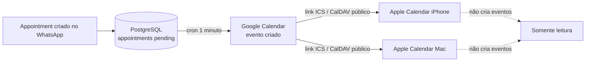

# 06 — Sincronização com Apple Calendar (iPhone / Mac)

> **Sumário**
>
> 1. [Modelo da integração: o Apple é apenas leitor](#1-modelo-da-integração-o-apple-é-apenas-leitor)
> 2. [Obter o link público do Google Calendar (ICS)](#2-obter-o-link-público-do-google-calendar-ics)
> 3. [Assinar no iPhone (CalDAV)](#3-assinar-no-iphone-caldav)
> 4. [Assinar no Mac (app Calendário)](#4-assinar-no-mac-app-calendário)
> 5. [O que aparece e o que não aparece no Apple Calendar](#5-o-que-aparece-e-o-que-não-aparece-no-apple-calendar)
> 6. [Solução de problemas](#6-solução-de-problemas)
> 7. [Fluxo completo de um agendamento até o iPhone](#7-fluxo-completo-de-um-agendamento-até-o-iphone)

---

## 1. Modelo da integração: o Apple é apenas leitor

Pontos importantes antes de configurar:

- **A Apple não expõe uma API pública de criação de eventos para contas CalDAV/ICS de terceiros** no fluxo desta solução. Não há nó no n8n que "cria evento no iPhone".
- Os eventos **nascem no PostgreSQL** (`appointments`), o workflow de sincronização os cria no **Google Calendar** (documento [04](04-importacao-workflow-n8n.md#6-configurar-o-workflow-de-sincronização-com-o-google-calendar)) e o **Apple Calendar consome** o calendário do Google por assinatura (ICS/CalDAV, somente leitura).
- O dono da barbearia (ou o barbeiro) usa o app Calendário do iPhone/Mac **para visualizar** a agenda; qualquer alteração (reagendar, cancelar) continua sendo feita pelo WhatsApp/n8n, e refletida no Google Calendar.

---

## 2. Obter o link público do Google Calendar (ICS)

1. Acesse `https://calendar.google.com` com a conta que recebeu a credencial `Google Calendar OAuth`.
2. No lado esquerdo, passe o mouse sobre o calendário desejado (ex.: `Agendamentos Barbearia`) → clique nos três pontos (**⋮**) → **Settings and sharing** (Configurações e compartilhamento).
3. Role até a seção **Integrate calendar** (Integrar calendário).
4. Copie um dos endereços abaixo conforme o uso:

| Endereço | Formato | Uso |
|---|---|---|
| **Calendar ID** | `...@group.calendar.google.com` ou e-mail da conta | Nó Google Calendar do n8n (campo `calendarId`) |
| **Secret address in iCal format** (endereço secreto no formato iCal) | `https://calendar.google.com/calendar/ical/<id>/private-xxxxxxxx/basic.ics` | Assinatura somente leitura no app Calendário do Mac e em clientes que aceitam ICS |
| **CalDAV** (servidor `https://caldav.google.com`) | Usa e-mail + senha de app | Assinatura CalDAV no iPhone (§3) |

> O endereço secreto do ICS permite quem o possui ver a agenda; não o publique em redes sociais. Se vazar, a mesma página tem botão para **Reset Secret Address**.

### 2.1 (Recomendado) Criar senha de app para o CalDAV do iPhone

Como a conta do Google provavelmente tem verificação em duas etapas:

1. Acesse `https://myaccount.google.com/security` → **2-Step Verification** ativada.
2. Entre em **App passwords** (Senhas de app) e gere uma senha com nome ex.: `calendario-iphone-barbearia`.
3. Guarde essa senha (não é a senha normal da conta) para o campo de senha do iPhone.

---

## 3. Assinar no iPhone (CalDAV)

Caminho no iOS (Ajustes → Calendário → Contas):

1. Abra **Ajustes** (Configurações) do iPhone.
2. Role até **Calendário** → **Contas** → **Adicionar Conta**.
3. Toque em **Outro** (última opção da lista).
4. Em **Calendários**, toque em **Adicionar conta CalDAV**.
5. Preencha:
   - **Servidor**: `caldav.google.com`
   - **Usuário**: e-mail completo da conta do Google (o mesmo que autorizou o OAuth)
   - **Senha**: a senha de app gerada na §2.1 (não a senha principal)
   - **Descrição**: ex.: `Agenda Barbearia`
6. Toque **Avançar**; aguide a verificação; ative o sincronismo de **Calendários** na tela seguinte e salve.
7. Abra o app **Calendário**; no botão de calendários (parte inferior/lateral), marque a conta recém-adicionada.

> Alternativa por ICS (somente leitura pura, sem CalDAV): em **Outro** → **Adicionar calendário por assinatura** → cole a URL `https://...basic.ics` da §2. No iOS, calendários por assinatura ICS costumam atualizar por push/pull conforme o Fetch New Data; o CalDAV tende a refletir alterações mais rápido.

---

## 4. Assinar no Mac (app Calendário)

1. Abra o app **Calendário** (Calendars) do macOS.
2. Menu superior **Arquivo (File)** → **Nova assinatura…** (New Subscription…).
3. Cole a URL secreta no formato iCal (`https://calendar.google.com/calendar/ical/.../basic.ics`) e clique **Inscrever-se**.
4. Na janela de opções:
   - Nome: `Agenda Barbearia`;
   - Cor conforme preferência;
   - **Atualização automática**: escolha **A cada hora** (ou mais frequente, se desejar);
   - Não marque "remover alarmes" se quiser receber lembretes dos eventos vindos do Google.
5. Clique **OK**. O calendário aparece na lista lateral; eventos já criados no Google Calendar são importados.

Para CalDAV no Mac (opção alternativa): **Calendário** → **Adicionar conta…** → **Conta CalDAV** → tipo de conta `Outro Mac OS X`/`Manual`, servidor `caldav.google.com`, usuário e senha de app da §2.1.

---

## 5. O que aparece e o que não aparece no Apple Calendar

| Ação | Onde acontece | Reflete no Apple Calendar? |
|---|---|---|
| Agendamento criado pela Bia no WhatsApp | `appointments` (PostgreSQL) → Google Calendar | **Sim**, após o sync marcar `synced` e o Apple atualizar a assinatura. |
| Reagendamento (nova data/hora) | Ferramenta `reschedule_appointment` → Google Calendar (update/delete+create) | **Sim** na próxima atualização. |
| Cancelamento dentro da política de 2h | `cancel_appointment` → Google Calendar remove o evento | **Sim**, o evento some na atualização. |
| Cancelamento fora da antecedência | Bloqueado pela ferramenta (`policy_violation=true`) | Não há evento novo; nada a refletir. |
| Criação de evento manual **no app Calendário do iPhone** | Fica armazenado localmente/iCloud | **Não** sobe para o n8n nem para o Google; por isso, evite agendar pelo iPhone — a fonte da verdade é o WhatsApp/PostgreSQL. |
| Evento com `calendar_sync_status = failed` | Não chegou ao Google Calendar | **Não** aparece no Apple; o retry do cron mantém `pending`/`failed` com até 5 tentativas. |

Limitações da assinatura:

- Avisos (alarme) e cores podem vir do Google; edição de convidados/anexos pelo Apple não tem efeito no sistema.
- Fuso horário: o Google Calendar usa o fuso do evento (`-03:00` no Brasil); mantenha o iPhone em fuso automático para evitar deslocamento de 1 hora.

---

## 6. Solução de problemas

| Sintoma | Causa provável | Solução |
|---|---|---|
| **Evento agendado não aparece no iPhone** | 1. Sync ainda `pending`/`failed`; 2. calendário não marcado na lista do app; 3. assinatura ICS com cache antigo; 4. evento foi criado em outro calendário do Google | 1. Conferir em **Executions** do workflow `workflow-calendar-sync` e coluna `calendar_sync_status` no banco; 2. abrir Calendário → lista de calendários e marcar a conta/assinatura; 3. puxar a lista para atualizar (CalDAV) ou editar a frequência (ICS); 4. conferir o `GOOGLE_CALENDAR_ID`/`calendarId` correto (documento [05](05-credenciais-e-segredos.md#6-calendário-obter-o-calendar-id)). |
| **Evento aparece com horário uma hora acima/abaixo** | Fuso do iPhone em manual ou evento salvo sem offset | Ajustar iPhone em **Ajustes → Geral → Data e Hora → Fuso automático**; confirmar `start_at` no PostgreSQL com `-03:00`. |
| **Cancelado no WhatsApp, continua no Apple** | Atualização do Apple ainda não ocorreu; evento removido no Google mas assinatura em cache | Aguardar o intervalo de atualização; no Mac, **Ver → Atualizar calendários**; no iPhone, puxar a tela na lista de calendários ou reiniciar o app; conferir se o Google Calendar web já não mostra o evento. |
| **Erro de autenticação CalDAV no iPhone** | Senha principal usada em vez de senha de app; 2FA bloqueia login direto | Gerar senha de app (§2.1) e repetir a §3; verificar que a conta está nos **Test users** do consentimento (caso o OAuth também falhe). |
| **Eventos antigos não importam** | Assinatura criada depois dos eventos; ICS traz apenas período futuro/atual por padrão | No Google Calendar web os eventos existem; expanda a janela de visualização no app Apple; eventos muito antigos não são exigidos para a operação. |
| **Atraso entre o agendamento e o aparecimento** | O cron roda a cada 1 minuto + cache da assinatura Apple (ICS pode levar minutos a horas) | É esperado; para conferência rápida, veja o Google Calendar web. Se o atraso for superior a ~10 minutos, revise o status `failed` e as tentativas em `calendar_sync_attempts`. |
| **O Apple mostra convite mas sem cliente/barbeiro** | Campo `description` vazio no nó Google Calendar | Conferir o nó **Criar Evento Google Calendar**: `description` deve conter barbeiro e telefone (contrato §7). |

---

## 7. Fluxo completo de um agendamento até o iPhone

1. Cliente manda mensagem no WhatsApp → ponte publica §2.1 no n8n.
2. Agente Gemini chama `book_appointment` → linha em `appointments` com `calendar_sync_status='pending'`.
3. Cron (1 minuto) busca pendentes → credencial `Google Calendar OAuth` cria o evento no calendário selecionado → status `synced` com `calendar_event_id`.
4. Google Calendar web mostra o evento na hora; iPhone/Mac com a conta CalDAV/assinatura ICS sincronizam em seguida (**somente leitura**).
5. Se o Google falhar (token expirado, quota), o agendamento continua seguro no banco; o cron retenta até 5 vezes; o cliente já recebeu o comprovante pela ferramenta.

Próximo: [07 — Prompt e regras de diálogo](07-prompt-e-regras-de-dialogo.md).
