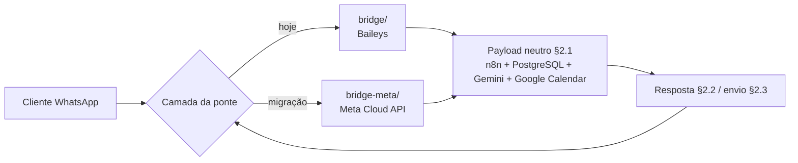

# 09 — Riscos do Baileys e migração para a Meta WhatsApp Cloud API

> **Sumário**
>
> - [Parte 1 — Riscos do uso não oficial e mitigações](#parte-1--riscos-do-uso-não-oficial-e-mitigações)
>   1. [Por que o Baileys é arriscado](#1-por-que-o-baileys-é-arriscado)
>   2. [Riscos detalhados](#2-riscos-detalhados)
>   3. [Mitigações recomendadas](#3-mitigações-recomendadas)
>   4. [Plano de contingência antes de um bloqueio](#4-plano-de-contingência-antes-de-um-bloqueio)
> - [Parte 2 — Migração oficial para a Meta WhatsApp Cloud API](#parte-2--migração-oficial-para-a-meta-whatsapp-cloud-api)
>   5. [Princípio: trocar só a ponte](#5-princípio-trocar-só-a-ponte)
>   6. [Tabela de equivalência: payload Baileys → Meta Cloud API](#6-tabela-de-equivalência-payload-baileys--meta-cloud-api)
>   7. [Checklist prático de migração](#7-checklist-prático-de-migração)
>   8. [Limitações da Cloud API que o adaptador deve respeitar](#8-limitações-da-cloud-api-que-o-adaptador-deve-respeitar)
>   9. [Estrutura do adaptador `bridge-meta/`](#9-estrutura-do-adaptador-bridge-meta)
>   10. [Alternativa de modelo: OpenAI `gpt-4o-mini`](#10-alternativa-de-modelo-openai-gpt-4o-mini)

---

## Parte 1 — Riscos do uso não oficial e mitigações

## 1. Por que o Baileys é arriscado

A ponte atual usa **`@whiskeysockets/baileys`**, uma biblioteca que implementa o protocolo web do WhatsApp fora dos clientes autorizados pela Meta. Ela **não é um produto oficial do WhatsApp**, não integra termos, não recebe SLA e não garante compatibilidade futura. Esta decisão foi tomada apenas para viabilizar o protótipo/local; a arquitetura foi desenhada desde o início para que a ponte seja substituída (§4 do [01-arquitetura.md](01-arquitetura.md)).

> **Aviso obrigatório:** o uso de bibliotecas não viola apenas uma convenção técnica — ele **viola os Termos de Serviço do WhatsApp/Meta** e pode causar bloqueio do número. Não utilize o número principal da barbearia em produção com Baileys.

## 2. Riscos detalhados

| Risco | Descrição | Impacto prático |
|---|---|---|
| **Violação dos Termos do WhatsApp/Meta** | O protocolo não oficial é proibido pelos termos de uso; a Meta pode detectar assinaturas de cliente e comportamento de automação. | Suspensão da conta sem aviso prévio; não há canal de suporte para recorrer. |
| **Bloqueio total do número** | O número para de enviar/receber mensagens em todos os aparelhos conectados. | Interrupção imediata do atendimento; clientes deixam de receber confirmações. |
| **Bloqueio temporário (rate limit / warning)** | Mensagens do tipo "você não pode enviar mensagens porque..." ou restrições por tempo. | Atendimento intermitente; queda de credibilidade. |
| **Sem SLA e sem garantia de versão** | A Meta muda o protocolo quando quiser; a biblioteca pode quebrar após atualização do WhatsApp Web. | Manutenção reativa; dia de bloqueio sem solução rápida. |
| **Banimento do chip/device associado** | Em casos graves, o número (linha celular) pode ser impedido de usar o WhatsApp; em alguns cenários o dispositivo também é afetado. | Necessidade de nova linha telefônica; clientes antigas não transferidas pelo chat oficial. |
| **Marcação como spam** | Mensagens não solicitadas, broadcasts ou alta frequência acionam denúncias e sistemas automáticos. | Piora da reputação do número; bloqueio mais provável. |
| **Privacidade e segurança da sessão** | As credenciais em `bridge/session/` equivalem ao login do WhatsApp; vazamento permite tomar a conta. | Uso indevido do número por terceiros. |
| **Funcionalidades ausentes** | Sem mensagens de template oficiais, sem métricas entregues/ lidas oficial, sem verificação de perfil comercial. | Diferença de recursos em relação à API oficial. |

## 3. Mitigações recomendadas

| Mitigação | Como aplicar |
|---|---|
| **Usar número comercial secundário** | Parear a ponte com um chip exclusivo do atendimento; nunca o número pessoal do proprietário. Mantenha o número de contato principal divulgado fora da automação até a migração oficial. |
| **Proibir broadcasts e mensagens não solicitadas** | A ponte só responde mensagens recebidas; não implementar disparo de promoções em massa, cobranças ou listas. A Cloud API também exige templates aprovados fora da janela de 24h (§8). |
| **Baixa frequência e intervalos** | Evitar rajadas de mensagens; respeitar `MESSAGE_TIMEOUT_MS`; não reenviar automaticamente mensagens falhadas sem intervalo. |
| **Monitorar `GET /health` e logs** | Checar `connected` periodicamente; em caso de `close` repetido no `connection.update`, encerrar a sessão em vez de insistir (reconexão com backoff já implementada, mas não substitui a decisão humana). |
| **Não armazenar segredos em repositório** | `.env`, `bridge/.env` e `bridge/session/` fora do versionamento (regras em [05](05-credenciais-e-segredos.md#2-regra-dourada-nunca-commite-segredos)). |
| **Plano de migração prontinho** | Manter o §7 desta documentação atualizado; ter conta no Meta for Developers criada com antecedência e número técnico aprovado. |
| **Backup dos dados de atendimento** | Os agendamentos estão no PostgreSQL (fonte da verdade); migrar a ponte não afeta o banco — mas mantenha dumps periódicos. |
| **Canais de contingência** | Manter telefone fixo/outro número e página de reserva de horários como plano B durante transição. |

## 4. Plano de contingência antes de um bloqueio

1. **Ao ver restrições ou aviso no número:** suspender novos envios, não tentar reconectar em loop, e registrar data/hora dos logs.
2. **Preservar o banco:** conferir que todos os `appointments` existem em PostgreSQL; exportar dump:
   ```bash
   docker exec db pg_dump -U barb_user -d barbearia > dump-barbearia.sql
   ```
3. **Acionar o plano oficial:** seguir a Parte 2 com a Meta Cloud API em outro número; os workflows e o prompt não mudam.
4. **Comunicar clientes** por canal alternativo sobre a mudança de número do atendimento automático.
5. Nunca tentar burlar bloqueios com múltiplos clones ou ferramentas similares não oficiais: isso aumenta o risco para os chips envolvidos.

---

## Parte 2 — Migração oficial para a Meta WhatsApp Cloud API

## 5. Princípio: trocar só a ponte



O contrato §2 do `spec/contrato-compartilhado.md` foi criado para isso:

- **Entrada (§2.1):** o adaptador Meta recebe o webhook da Meta e o converte no mesmo JSON neutro (`provider` passa a ser `"meta"`).
- **Resposta (§2.2):** o n8n continua respondendo `{ "messages": [...], "human_handoff": false }`; o adaptador Meta traduz para chamadas de envio da API.
- **Envio assíncrono (§2.3):** `POST /send` e `GET /health` continuam existindo no novo adaptador, com o mesmo formato.
- **Sem mudança:** `docker-compose.yml`, workflows em `n8n/`, `database/schema.sql`, `database/seed.sql`, `config/agent-prompt.md` e credenciais de banco/Gemini/Google Calendar.

## 6. Tabela de equivalência: payload Baileys → Meta Cloud API

O adaptador `bridge-meta/` deve fazer esta conversão **na ponta**, nunca deixando campos da Meta vazarem para o n8n.

### 6.1 Mensagem recebida (webhook da Meta → §2.1)

| Campo neutro (§2.1) | Origem no Baileys (atual) | Origem no webhook da Meta Cloud API |
|---|---|---|
| `provider` | `"baileys"` fixo | `"meta"` fixo |
| `wa_id` | Remetente do JID (`5511999990000@s.whatsapp.net` → sem sufixo) | `entry[].changes[].messages[].from` (dígitos do WhatsApp ID) |
| `sender_name` | `pushName` da chave remetente | `entry[].changes[].contacts[].profile.name` |
| `message_id` | `key.id` | `entry[].changes[].messages[].id` (formato `wamid....`) |
| `message_type` | Tipo extraído do objeto (`conversation`, `extendedTextMessage`, `imageMessage`, `audioMessage`…) | `entry[].changes[].messages[].type` (`text`, `image`, `audio`, `document`, `video`…) |
| `message_text` | `message.conversation \|\| message.extendedTextMessage?.text`; mídia → aviso genérico | `messages[].text.body` para `type = text`; demais tipos → aviso genérico de que só texto é suportado |
| `timestamp` | `messageTimestamp` (segundos) convertido para ms | `messages[].timestamp` (string de segundos) convertido para ms |

### 6.2 Resposta enviada (§2.2/§2.3 → API da Meta)

| Etapa neutra | Baileys (atual) | Meta Cloud API |
|---|---|---|
| Enviar texto | `sock.sendMessage(jid, { text })` | `POST https://graph.facebook.com/v21.0/<PHONE_NUMBER_ID>/messages` com `{ "messaging_product": "whatsapp", "to": "<wa_id>", "type": "text", "text": { "body": "<texto>" } }` |
| Endpoint interno da ponte | `POST http://localhost:3000/send` | Manter `POST /send` com `{ "to", "text" }`; a ponte converte para a chamada Graph API |
| Healthcheck | `GET /health → connected` | `GET /health` deve refletir validade do token e última chamada à API (ex.: teste de `GET .../<PHONE_NUMBER_ID>`) |
| Falha de entrega | Fallback amigável + backoff | Tratar `messages[].errors[]` e `statuses[]`; mesmo contrato de fallback §2.3 (`{ "ok": false, "error": "..." }`) |
| Status de entrega | Não disponível no Baileys | Array `statuses[]` (sent/delivered/read/failed) → o adaptador apenas registra em log; não altera o §2.1 |

### 6.3 Diferenças que o adaptador deve tratar

| Tema | Regra na Cloud API |
|---|---|
| Janela de mensagens livres | Texto gratuito só pode ser enviado **dentro de 24h** após a última mensagem do cliente; fora, usar **mensagens de template** aprovadas (§8). |
| Templates | Estrutura `{ "type": "template", "template": { "name": "...", "language": { "code": "pt_BR" }, "components": [...] } }`. |
| Verificação do webhook | Meta envia `GET` com `hub.mode`, `hub.verify_token`, `hub.challenge`; adaptador responde `hub.challenge` com status 200. Depois recebe `POST` com os eventos. |
| Token | Permanent System User Token (não o token de 24h do início dos testes); escopos `whatsapp_business_messaging` e `whatsapp_business_management`. |

## 7. Checklist prático de migração

### 7.1 Criar o aplicativo no Meta for Developers

1. Acessar `https://developers.facebook.com/` → **My Apps** → **Create App** → categoria **Business**.
2. No painel, **Add Product** → **WhatsApp** (recurso WhatsApp).
3. Na guia **API Setup**, observar:
   - **Temporary access token** (uso apenas de teste; trocar pelo permanente depois);
   - **Phone Number ID** do número de teste (campo `PHONE_NUMBER_ID` do adaptador);
   - **WhatsApp Business Account ID (WABA ID)**;
   - Número de telefone próprio cadastrado em **Phone Numbers**.
4. Adicionar o número real da barbearia: solicitar código de verificação por SMS/ligação; aprovar o nome de exibição (display name) na conta comercial.

### 7.2 Gerar token permanente

1. No painel do negócio (`business.facebook.com`), criar **System User** com papel de administrador para o app.
2. Gerar token com escopos `whatsapp_business_messaging` e `whatsapp_business_management`, expiração **never** (permanente).
3. Guardar o token em segredo no ambiente do adaptador (variável de ambiente; nunca no repositório).

### 7.3 Configurar o webhook de entrada

1. No WhatsApp → **Configuration** → **Webhook** → **Edit**:
   - **Callback URL**: endpoint público do adaptador `bridge-meta/` (ex.: `https://seuservidor/meta/incoming`); em desenvolvimento local, usar túnel seguro (ex.: Cloudflare Tunnel/ngrok) temporário.
   - **Verify Token**: escolher uma string secreta (`META_VERIFY_TOKEN`) e usar a mesma no adaptador.
2. Clique em **Verify and save**: a Meta envia `GET` com desafio; o adaptador responde com `hub.challenge`.
3. Em **Webhook fields**, inscrever pelo menos: **`messages`** e **`statuses`**.
4. Confirmar recebimento: enviar mensagem do número teste e observar o payload bruto antes de traduzir para o §2.1.

### 7.4 Montar o adaptador `bridge-meta/`

1. Criar a pasta `bridge-meta/` com o mesmo contrato:
   - `POST /send` → `{ "to", "text" }`;
   - `GET /health` → `{ "status": "ok", "connected": true/false }`;
   - Publicação em `N8N_WEBHOOK_URL` com o §2.1;
   - Consumo da resposta §2.2.
2. Variáveis esperadas no `.env` próprio:

```dotenv
N8N_WEBHOOK_URL=http://localhost:5678/webhook/whatsapp/incoming
PORT=3000
META_PHONE_NUMBER_ID=__PHONE_NUMBER_ID__
META_ACCESS_TOKEN=__PERMANENT_SYSTEM_USER_TOKEN__
META_VERIFY_TOKEN=__ESCOLHA_UMA_SENHA__
META_GRAPH_VERSION=v21.0
MESSAGE_TIMEOUT_MS=25000
FALLBACK_MESSAGE=Desculpe! Estou com uma instabilidade no momento. Pode tentar novamente em instantes?
```

3. Implementar a conversão da §6.1 (entrada) e §6.2 (saída).
4. Remover/desativar a pasta `bridge/` apenas após os testes; não alterar nenhum JSON em `n8n/`.

### 7.5 Validar sem mexer no n8n

1. No n8n, os workflows permanecem com os mesmos placeholders já preenchidos; a única diferença visível nos logs é `provider: "meta"`.
2. Rodar o [checklist de testes manuais](08-checklist-testes-manuais.md) completo; itens que dependiam de QR/pareamento (14) são substituídos pela checagem de reinício do adaptador e do estado em `conversation_state`.
3. Confirmar `human_tickets`, `appointments` e Google Calendar com os mesmos comportamentos.
4. Documentar no README que a ponte ativa é `bridge-meta/`; manter `bridge/` apenas como referência histórica ou remover com aprovação.

## 8. Limitações da Cloud API que o adaptador deve respeitar

| Regra | Detalhe | Implicação no projeto |
|---|---|---|
| **Janela de 24h** | Mensagens de texto livres só são aceitas se o cliente tiver mandado mensagem nos últimos 24h. | Lembretes de agendamento fora da janela precisam de **template aprovado** (ex.: `appointment_reminder` com variáveis de data/serviço). |
| **Templates aprovados** | Nomes e idiomas são analisados pela Meta; componentes suportam texto, imagens e botões. | Criar templates na guia **Message Templates** (status `Approved` antes do uso); adaptador escolhe `text` ou `template` conforme o contexto. |
| **Sem envio para números que não iniciaram conversa** | Proíbe abordagem fria; a Compliance da Meta restringe mensagens promocionais não solicitadas. | Mantém a regra de não fazer broadcasts, alinhada às mitigações da Parte 1. |
| **Status e métricas** | `statuses` trazem `sent`, `delivered`, `read`, `failed`; erros com códigos e mensagens. | Adaptador registra logs; não há mudança no §2.1; métricas podem virar relatório futuro. |
| **Mídia** | Enviar/baixar mídia exige IDs de mídia; a versão atual do sistema só trata texto, como no Baileys. | Manter o aviso de que mídia não textual não é atendida. |
| **Concorrência com webhook de teste do n8n** | A URL da Meta é pública; o n8n continua escutando `whatsapp/incoming` localmente. | O adaptador é o único exponível; o n8n não precisa ficar público. |

## 9. Estrutura do adaptador `bridge-meta/`

Sugestão de arquivos (o contrato mínimo é o comportamento, não os nomes internos além das pastas):

```
bridge-meta/
├── package.json            # "type": "module"; deps: express, node-fetch/nativo fetch, pino
├── server.js               # Webhook GET (verify) + POST (converter §2.1), /send, /health
├── .env.example            # Variáveis da §7.4 (placeholders __...)
└── README.md               # Como obter token, PHONE_NUMBER_ID e verify token
```

Contratos mantidos em relação à §2 do contrato:

1. `POST {N8N_WEBHOOK_URL}` com `provider: "meta"`, mesmos campos da §2.1.
2. Consumo da resposta §2.2 com `messages[]` e `human_handoff`.
3. `POST /send` → `{ "to", "text" }`, resposta `{ "ok": true, "sent": true }` ou `{ "ok": false, "error": "..." }`.
4. `GET /health` → `{ "status": "ok", "connected": true/false }`.

Não implementar no adaptador: regras de horário, preços, política de cancelamento ou consulta a banco — isso permanece nos sub-workflows de `n8n/tools/`.

## 10. Alternativa de modelo: OpenAI `gpt-4o-mini`

Caso a chave do Google Gemini esteja indisponível ou a equipe prefira outro fornecedor, o nó de modelo pode ser trocado sem mudar as ferramentas:

- Adicionar credencial **OpenAiApi** e nó `n8n-nodes-langchain.lmChatOpenAi` com modelo `gpt-4o-mini`;
- Conectar ao **Agente Gemini (Ferramentas)** no lugar do `n8n-nodes-langchain.lmChatGoogleGemini`;
- Manter `config/agent-prompt.md` e os seis `toolWorkflow` intactos.

O padrão recomendado continua sendo **Gemini `gemini-2.0-flash`** (free tier generoso, desempenho em pt-BR, nó nativo); a troca é uma contingência, não uma necessidade.

---

### Documentos relacionados

- [01 — Arquitetura](01-arquitetura.md) — princípio do adaptador isolado e diagrama completo.
- [03 — Ponte Baileys](03-ponte-baileys-whatsapp.md) — comportamento da ponte atual substituída.
- [05 — Credenciais e segredos](05-credenciais-e-segredos.md) — regra de nunca expor tokens.
- [08 — Checklist de testes](08-checklist-testes-manuais.md) — validação após a migração.
